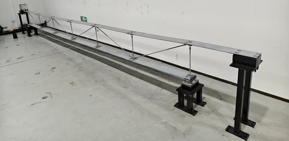
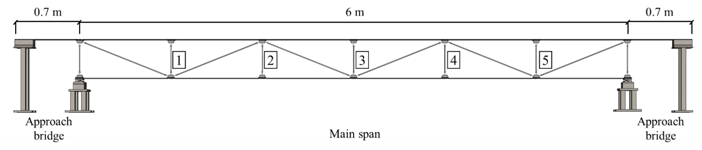
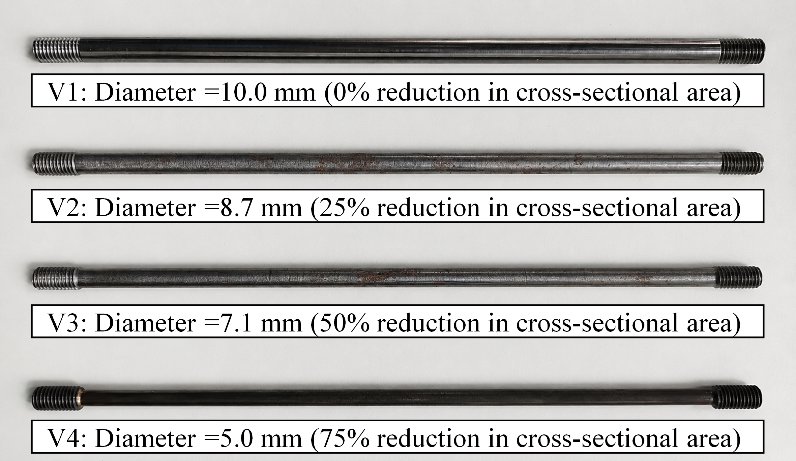
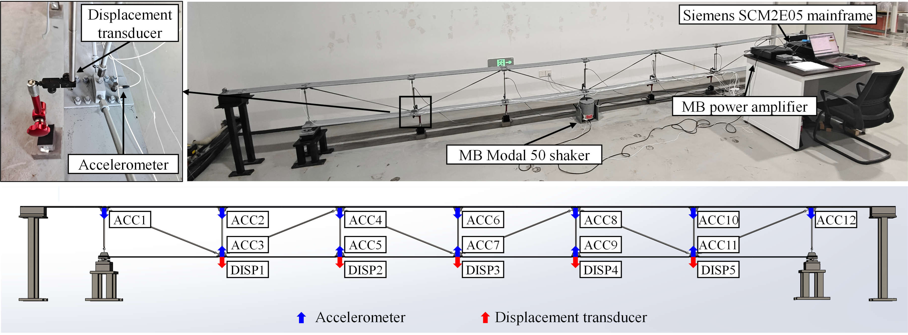

# Truss-Bridge-Model-Vibration-Benchmark-Dataset
## 📖 Overview

This dataset provides benchmark vibration data for a truss bridge model under two types of excitation. It can be used as a benchmark dataset for validating methods in moving load identification, modal identification, structural model updating, and structural anomaly detection, among others.

## Truss Bridge Model

A laboratory-scale steel truss bridge model was constructed for vibration testing. The bridge consists of a **6.0 m main span** and two **0.7 m approach spans**. All primary structural members are made of Q235 steel. The upper and lower chords have rectangular cross-sections of 150 mm × 5 mm, while the intermediate members have circular cross-sections with a diameter of 10 mm. The main span is simply supported, and the structural members are connected through bolted joints.

  Fig. 1. The truss bridge model.

## Test scenarios

The bridge model is designed with easily detachable vertical members, allowing different anomaly locations and severities to be simulated by replacing members with different cross-sectional sizes. The structural anomaly cases are simulated by reducing the cross-sectional areas of selected vertical members. The easily detachable vertical members are designed with four different sizes, and their corresponding diameters and cross-sectional reduction ratios are illustrated in Fig. 3.

By sequentially replacing the vertical members at the five locations with the three reduced-section members, **15 damaged conditions (Cases 1–15)** are generated, together with one undamaged reference condition (Case 0).

  Fig. 2. The detachable vertical members.

Two types of dynamic excitation are employed in the experiments:
- **Shaker-induced excitation:** White-noise excitation is applied using an MB Dynamics Modal 50 shaker at five designated locations along the main span.
- **Vehicle-induced excitation:** A scaled two-axle vehicle travels across the bridge under three different vehicle weights (**9.65 kg, 14.65 kg, and 19.65 kg**) to simulate moving loads.

## Data Acquisition
The vibration responses are measured using **12 accelerometers and 5 displacement transducers**, with a sampling frequency of **512 Hz**. The sensor placement is shown in Fig. 3. For shaker-induced tests, acceleration responses are recorded for 512 s, while vehicle-induced tests record both acceleration and displacement responses for 40 s.

  Fig. 4. The detachable vertical members.

## 📥 Dataset Download

The complete dataset is publicly available through the following platforms:

| Platform | Download |
|:---|:---|
|  **Baidu Netdisk** | [Download Dataset](https://pan.baidu.com/s/1VPeSs4PSzYhjfpAPyXlW-Q?pwd=u7tg) |
|  **Google Drive** | [Download Dataset](https://drive.google.com/drive/folders/1I5ez2_0RFDQFCa35PJ9AjpGVECRVmFLx?usp=sharing) |

## 📚 Citation

For more detailed information about the benchmark dataset usage and related structural anomaly detection methods, readers may refer to the following publications:

**1. Benchmark Dataset and Validation Study**

Hua-Ping Wan, Yi-Kai Zhu, Can Wang, Michael D. Todd. **Multiscale pattern learning for vibration-based structural anomaly detection: A benchmark dataset and validation study.** *Structural Health Monitoring*. 2026.

[https://doi.org/10.1177/14759217261499477](https://doi.org/10.1177/14759217261499477)

Hua-Ping Wan, Yi-Kai Zhu, Yaozhi Luo, Michael D. Todd. **Unsupervised deep learning approach for structural anomaly detection using probabilistic features.** *Structural Health Monitoring*. 2025;24(1):3–33.

[https://doi.org/10.1177/14759217241226804](https://doi.org/10.1177/14759217241226804)
